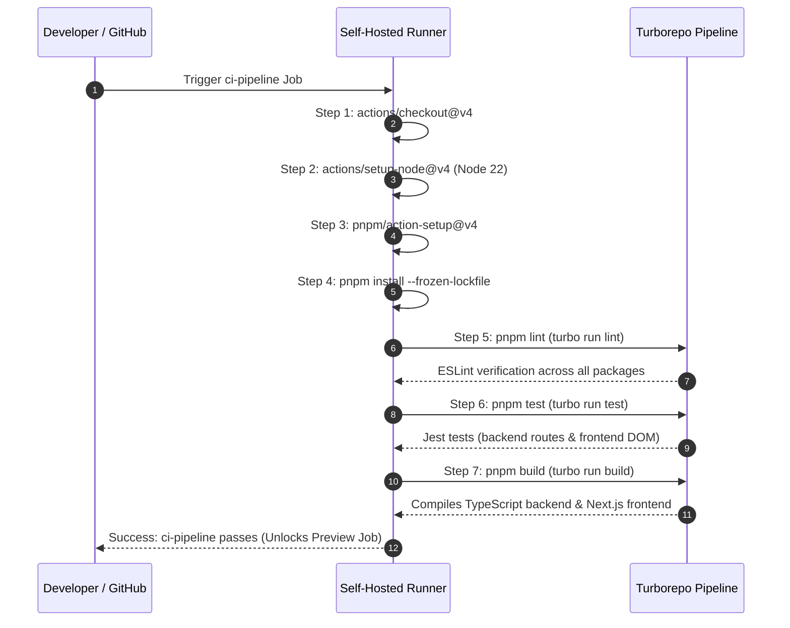
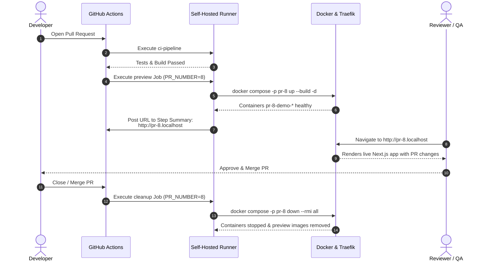
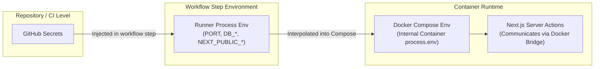

# CI/CD Documentation: GitHub Actions, Self-Hosted Runner, Docker & Traefik

Welcome to the comprehensive CI/CD operational guide for this Turborepo full-stack application. This document details the Continuous Integration and Continuous Deployment pipeline implemented using **GitHub Actions**, a **self-hosted GitHub Actions runner**, **Docker Compose**, and the **Traefik reverse proxy**.

---

## Table of Contents

1. [A. CI/CD Overview](#a-cicd-overview)
2. [B. Actual Project Structure](#b-actual-project-structure)
3. [C. CI Pipeline: Pull Request Validation](#c-ci-pipeline-pull-request-validation)
4. [D. GitHub Actions Workflows and Triggers](#d-github-actions-workflows-and-triggers)
5. [E. Self-Hosted GitHub Actions Runner](#e-self-hosted-github-actions-runner)
6. [F. Docker Build and Deployment Process](#f-docker-build-and-deployment-process)
7. [G. Traefik Reverse Proxy & Dynamic Routing](#g-traefik-reverse-proxy--dynamic-routing)
8. [H. Pull Request Preview Deployments](#h-pull-request-preview-deployments)
9. [I. Automatic Production Deployment](#i-automatic-production-deployment)
10. [J. Pipeline Failure Notifications](#j-pipeline-failure-notifications)
11. [K. Environment Variables and Secrets](#k-environment-variables-and-secrets)
12. [L. Rollback and Recovery Procedures](#l-rollback-and-recovery-procedures)
13. [M. Monitoring, Debugging, and Troubleshooting](#m-monitoring-debugging-and-troubleshooting)
14. [N. Pipeline Reference & Cheat Sheet](#n-pipeline-reference--cheat-sheet)

---

## A. CI/CD Overview

### Definitions

- **Continuous Integration (CI)**: The automated practice of frequently merging code changes into a shared repository branch, followed by automated verification (installing dependencies, linting, running unit/integration tests, and compiling/building). CI ensures that software regressions and compilation errors are identified immediately before merging.
- **Continuous Delivery (CD)**: The capability to deploy validated code to any target environment (staging, previews, or production) at any moment via automated scripts, though deployment to production may require a manual trigger or approval gate.


### Why This Project Uses an Automated Pipeline

In this full-stack monorepo (Next.js frontend, Express backend, PostgreSQL database, and shared workspace packages), manual validation and deployments introduce major risks:
- Developers might push code that breaks shared TypeScript interfaces or violates ESLint rules.
- Local tests might pass on one machine while failing on another due to differing Node or dependency versions.
- Reviewing pull requests without visual confirmation is error-prone.
- Manual Docker builds and container restarts consume valuable developer time.

This automated pipeline guarantees:
1. Every Pull Request (PR) is automatically validated with linting, unit tests, and production builds.
2. Every active PR receives its own isolated, live preview environment (`http://pr-${PR_NUMBER}.localhost`) managed dynamically by Traefik.
3. Closing a PR automatically tears down its preview containers and frees disk space.
4. Pipeline failures dispatch automated Slack webhook notifications.

###
### Implemented vs. Missing Features

| Feature | Status | Notes |
|---|---|---|
| **Pull Request Code Validation (CI)** | **Implemented** | Automatically runs `pnpm lint`, `pnpm test`, and `pnpm build` across all workspace apps and packages. |
| **Local Self-Hosted Runner Execution** | **Implemented** | Jobs run locally on host (`runs-on: self-hosted`), allowing direct Docker daemon and local network integration. |
| **Automated PR Preview Deployments** | **Implemented** | Ephemeral Compose projects (`pr-${PR_NUMBER}`) automatically build and launch on PR open/update. |
| **Dynamic Host Routing with Traefik** | **Implemented** | Traefik routes incoming `http://pr-${PR_NUMBER}.localhost` traffic directly to the active preview container. |
| **Automated PR Preview Teardown** | **Implemented** | Closing a PR automatically triggers the `cleanup` job, running `docker compose down --rmi all`. |
| **Pipeline Failure Notifications** | **Implemented** | Sends rich failure alerts to Slack via webhook on any job failure. |
| **Git Pre-commit & Pre-push Hooks** | **Implemented** | Enforced via `lefthook.yml` to prevent broken code from being pushed to GitHub. |
| **Automated Production Deployment** | **Missing** | Merges to `main` run validation checks but **do not** deploy to a dedicated production environment. Production deployment is currently manual. | |

---

## B. Actual Project Structure

The files and directories governing the CI/CD pipeline in this repository are:

```text
full-stack-nextjs/
├── .github/
│   └── workflows/
│       └── production.yaml             # Unified GitHub Actions workflow (CI, Preview, Cleanup, Slack)
├── apps/
│   ├── backend/
│   │   ├── Dockerfile                  # Production multi-stage Docker build for backend API
│   │   ├── package.json                # Backend scripts ("lint", "test", "build")
│   │   ├── src/
│   │   │   ├── health_check.ts         # Healthcheck script executed by Docker container probe
│   │   │   └── database/schema.sql     # Database schema loaded on PostgreSQL startup
│   │   └── test/
│   │       └── routes/                 # Jest integration tests mocking database pool
│   └── frontend/
│       ├── Dockerfile                  # Standalone Next.js multi-stage Docker build
│       ├── package.json                # Frontend scripts ("lint", "test", "build")
│       ├── next.config.ts              # Next.js standalone build configuration
│       └── tests/                      # Frontend component and page test suites
├── packages/
│   ├── eslint-config/                  # Shared ESLint configuration rules
│   ├── typescript-config/              # Shared tsconfig definitions
│   └── ui/                             # Shared React component library
├── docker-compose.yml                  # Application services definition (demo-backend & demo-frontend)
├── docker-compose-infrastructure.yml   # Database service definition (postgres_db)
├── docker-compose-proxy.yml            # Reverse proxy service definition (Traefik v3)
├── lefthook.yml                        # Git pre-commit and pre-push hook configuration
├── package.json                        # Root monorepo scripts ("lint", "test", "build")
├── pnpm-lock.yaml                      # Pinned lockfile for dependencies
├── pnpm-workspace.yaml                 # Monorepo workspace configuration
└── turbo.json                          # Turborepo task dependencies and cache pipeline
```

### Purpose of Key CI/CD Files

- **`.github/workflows/production.yaml`**: The primary GitHub Actions configuration file containing the four workflow jobs: `ci-pipeline`, `preview`, `cleanup`, and `notify-slack`.
- **`lefthook.yml`**: Configures client-side Git hooks. Runs `pnpm lint` on pre-commit and `pnpm lint && pnpm build` on pre-push.
- **`turbo.json`**: Defines task execution pipelines and caching semantics (`build`, `lint`, `test`) across workspace packages.
- **`docker-compose.yml`**: Defines the application containers (`demo-backend` and `demo-frontend`) with Compose labels enabling Traefik dynamic routing.
- **`docker-compose-proxy.yml`**: Deploys the Traefik reverse proxy listening on ports 80 and 8080.
- **`docker-compose-infrastructure.yml`**: Deploys PostgreSQL 17 on the shared `custom-network`.

---

## C. CI Pipeline: Pull Request Validation

Whenever a developer opens or updates a Pull Request targeting `main`, the `ci-pipeline` job validates code integrity.



### Detailed Step Breakdown

1. **Checkout Code (`actions/checkout@v4`)**:
   Fetches the commit SHA from the PR branch into the runner workspace.
2. **Setup Node.js (`actions/setup-node@v4`)**:
   Configures Node.js version `22` on the runner environment.
3. **Setup pnpm (`pnpm/action-setup@v4`)**:
   Activates `pnpm` on the runner without hardcoding a global version, matching workspace specifications.
4. **Install Dependencies (`pnpm install --frozen-lockfile`)**:
   Enforces deterministic dependency resolution using `pnpm-lock.yaml`. If package manifests and lockfiles do not match, the installation fails immediately.
5. **Lint Checks (`pnpm lint`)**:
   Executes `turbo run lint`. Turborepo evaluates all workspaces in parallel:
   - Backend: Runs `eslint .`
   - Frontend: Runs `next lint` / `eslint .`
   - Shared packages: Verifies rules from `@repo/eslint-config`.
6. **Automated Tests (`pnpm test`)**:
   Executes `turbo run test`. Runs Jest test suites across both applications:
   - `apps/backend/test/routes/task.route.test.ts`: Verifies REST CRUD endpoints using Supertest with mocked PostgreSQL query pools.
   - `apps/frontend/tests/`: Verifies DOM rendering and user events using React Testing Library and Jest DOM.
7. **Production Build (`pnpm build`)**:
   Executes `turbo run build`. Turborepo respects dependency topological order (`^build`):
   - Compiles TypeScript for backend (`tsc`).
   - Compiles Next.js frontend in `standalone` mode (`next build`).

### Failure Behavior & Branch Protection

- **Exit Codes**: If any step exits with a non-zero exit code (e.g., TypeScript compile error, failed assertion in Jest, or ESLint warning configured as error), the job terminates immediately.
- **Enforcing Checks via GitHub Rulesets**:
  To prevent unverified code from merging into `main`, configure Branch Protection or Repository Rulesets in GitHub:
  1. Navigate to **Settings > Branches** (or **Rules > Rulesets**).
  2. Target branch: `main`.
  3. Enable **Require status checks to pass before merging**.
  4. Specify the required check name: `ci-pipeline`.
  5. Enable **Require branches to be up to date before merging**.

---

## D. GitHub Actions Workflows and Triggers

The repository workflow is defined in [`.github/workflows/production.yaml`](file:///home/er/Desktop/full-stack-nextjs/.github/workflows/production.yaml).

### Trigger Events and Filter Rules

```yaml
name: production-ci
on:
  push:
    branches: [main]
  pull_request:
    branches: [main]
    types: [opened, synchronize, reopened, closed]
```

- **`push: branches: [main]`**: Fires whenever commits are pushed directly to `main` or when a pull request is merged into `main`.
- **`pull_request: branches: [main]`**:
  - `opened`: A new PR targeting `main` is created.
  - `synchronize`: New commits are pushed to the source branch of an open PR.
  - `reopened`: A closed PR is reopened.
  - `closed`: A PR is either merged or closed without merging.

### Job Execution Matrix and Conditions

```yaml
jobs:
  ci-pipeline:
    if: github.event_name == 'push' || github.event.action != 'closed'
    runs-on: self-hosted
    ...

  preview:
    if: github.event_name == 'pull_request' && github.event.action != 'closed'
    needs: ci-pipeline
    runs-on: self-hosted
    ...

  cleanup:
    if: github.event_name == 'pull_request' && github.event.action == 'closed'
    runs-on: self-hosted
    ...

  notify-slack:
    needs:
      - ci-pipeline
      - preview
      - cleanup
    if: ${{always() && (needs.cleanup.result == 'failure' || needs.preview.result == 'failure' || needs.ci-pipeline.result == 'failure')}}
    runs-on: self-hosted
    ...
```

#### Job Dependency Logic:
1. **On PR Open / Sync / Reopen**:
   - `ci-pipeline` runs first.
   - If `ci-pipeline` succeeds, `preview` executes (`needs: ci-pipeline`).
   - If either fails, `notify-slack` executes.
2. **On PR Closed (or Merged)**:
   - `ci-pipeline` is skipped because `github.event.action == 'closed'`.
   - `preview` is skipped.
   - `cleanup` runs immediately to remove preview containers.
   - If `cleanup` fails, `notify-slack` executes.
3. **On Push to `main`**:
   - `ci-pipeline` executes.
   - `preview` and `cleanup` are skipped.
   - If `ci-pipeline` fails, `notify-slack` executes.

### Concurrency Gap Analysis and Recommendation

> [!WARNING]
> **Missing Concurrency Control**:
> The workflow currently lacks a `concurrency` configuration. If a developer pushes three commits in rapid succession to a pull request, GitHub Actions will trigger three parallel workflow runs. Because they all execute on the same local self-hosted runner and target the same Compose project (`pr-${PR_NUMBER}`), Docker build and startup commands will race each other.

#### Recommended Fix:
Add a top-level concurrency block to `.github/workflows/production.yaml`:

```yaml
concurrency:
  group: ${{ github.workflow }}-${{ github.event.pull_request.number || github.ref }}
  cancel-in-progress: true
```
This guarantees that any in-flight preview build is safely canceled when new commits are pushed.

---

## E. Self-Hosted GitHub Actions Runner

### Why a Self-Hosted Runner Is Used

A self-hosted runner executes workflow jobs directly on your physical development workstation rather than inside GitHub-managed virtual machines in Azure.

#### Key Architectural Reasons:
1. **Direct Docker Daemon Access**: The runner interacts with the host's native Docker socket (`/var/run/docker.sock`), allowing it to build containers and spin up Compose projects natively without needing Docker-in-Docker (DinD).
2. **Local Dynamic Routing**: Previews are exposed on `http://pr-${PR_NUMBER}.localhost`. Because `*.localhost` resolves to loopback IP (`127.0.0.1`), the developer can access preview environments locally without external DNS or public IPs.
3. **Monorepo Build Performance**: Dependencies and Docker layers are cached on the host filesystem, speeding up builds compared to spinning up clean cloud VMs on every commit.

### How the Runner Communicates with GitHub

The self-hosted runner runs an application daemon written in .NET Core:
- **Outbound Only**: The runner connects outbound to GitHub servers (`https://api.github.com` and `https://github.com`) via HTTPS over port **443** using long-polling.
- **No Open Inbound Ports**: The host does **not** need to open firewall ports or expose a public IP address to receive workflow jobs.
- **Job Execution Sandbox**: When a job matches `runs-on: self-hosted`, the runner forks a child process on the host machine running under the OS user account (e.g. `er`), cloning the repo into `_work/` and running bash commands directly.

### Host Software Requirements

The host machine running the runner must have the following tools installed and available in `$PATH`:
- **Operating System**: Linux (Ubuntu/Debian recommended), macOS, or Windows (WSL2).
- **Node.js**: Version 22.x or higher.
- **pnpm**: Version 9.x or higher.
- **Docker Engine & Docker Compose**: Docker 24+ and Compose V2 plugin (`docker compose`).
- **Core CLI Utilities**: `curl`, `git`, `bash`.

### Managing and Checking Runner Status

#### 1. Checking Runner Status on GitHub
Navigate to:
**Repository > Settings > Actions > Runners**
- A green dot indicates the runner is **Idle** and listening for jobs.
- A red dot indicates the runner is **Offline**.

#### 2. Starting the Runner Manually
If installed interactively in an `actions-runner` directory:
```bash
cd ~/actions-runner
./run.sh
```

#### 3. Managing the Runner as a System Service
If installed as a systemd service:
```bash
# Check status
sudo ./svc.sh status
# Or via systemctl
sudo systemctl status actions.runner.*

# Start / Stop / Restart
sudo ./svc.sh start
sudo ./svc.sh stop
sudo ./svc.sh restart
```

### What Happens When the Host Machine Is Offline

- If the host machine is shut down, asleep, or disconnected from the internet, queued GitHub Actions jobs will remain in a **Queued** state.
- GitHub retains queued jobs for up to **24 hours**.
- As soon as the local runner service reconnects, it immediately dequeues and executes pending jobs in arrival order.

### Security Considerations for Self-Hosted Runners

> [!CAUTION]
> **Critical Security Warning**:
> Self-hosted runners execute arbitrary shell commands on your physical workstation with the permissions of the runner OS user.
> 
> 1. **Public Repository Danger**: Never attach a self-hosted runner to a public GitHub repository. Anyone opening a PR could execute malicious scripts, access the Docker daemon, read private SSH keys in `~/.ssh`, or compromise your local network.
> 2. **Docker Socket as Root**: Anyone with access to `/var/run/docker.sock` effectively has root permissions on the host system because they can mount the host root filesystem (`-v /:/host`).
> 3. **Forked Pull Requests**: By default, GitHub does not execute workflows on self-hosted runners for forks without manual maintainer approval. Keep this restriction enabled under **Settings > Actions > General > Fork pull request workflows from outside collaborators**.

---

## F. Docker Build and Deployment Process

### Multi-Stage Build Strategy

Images are built locally by the runner using the root build context (`context: .`):
- **Backend Image (`apps/backend/Dockerfile`)**:
  1. `base`: `node:24-alpine` enabling Corepack.
  2. `deps`: Copies workspace manifests and runs `pnpm install --frozen-lockfile`.
  3. `builder`: Compiles TypeScript with `npx turbo build --filter=backend` and prunes runtime modules into `/prod/backend` using `pnpm --filter backend deploy --prod`.
  4. `runner`: Distroless runtime (`gcr.io/distroless/nodejs24-debian13`) containing strictly the Node.js executable and compiled files (`dist/src/server.js`).
- **Frontend Image (`apps/frontend/Dockerfile`)**:
  1. Compiles standalone Next.js bundle using `output: "standalone"` in `next.config.ts`.
  2. Copies standalone server, `.next/static`, and `public` assets to the Distroless runner.

### Isolated Deployment Execution

In the `preview` job of `.github/workflows/production.yaml`:
```bash
docker compose \
  -p pr-${PR_NUMBER} \
  up \
  --build \
  -d
```

- **Compose Project Namespace (`-p pr-${PR_NUMBER}`)**:
  The `-p` flag namespaces every resource created by Compose. For example, for Pull Request #8:
  - Containers: `pr-8-demo-backend-1`, `pr-8-demo-frontend-1`
  - Volumes & labels are scoped exclusively to project `pr-8`.
  - Multiple PRs can run concurrently without name collisions!

### Environment Variable Injection

Secrets configured in GitHub Repository Settings are passed into the step execution environment:
```yaml
env:
  PORT: ${{secrets.PORT}}
  POSTGRES_USER: ${{secrets.POSTGRES_USER}}
  POSTGRES_PASSWORD: ${{secrets.POSTGRES_PASSWORD}}
  POSTGRES_DB: ${{secrets.POSTGRES_DB}}
  DB_HOST: ${{secrets.DB_HOST}}
  DB_PORT: ${{secrets.DB_PORT}}
  NEXT_PUBLIC_BASE_URI: ${{secrets.NEXT_PUBLIC_BASE_URI}}
```
Docker Compose reads these process environment variables on the runner and substitutes them into `${PORT}`, `${POSTGRES_USER}`, etc., inside `docker-compose.yml`. Secrets are never hardcoded in Dockerfiles or checked into Git.

---

## G. Traefik Reverse Proxy & Dynamic Routing

Traefik acts as the intelligent edge router for all preview and host traffic.

### Traefik Architecture in This Project

- **Service Definition**: Configured in `docker-compose-proxy.yml` using image `traefik:v3.6.13`.
- **Published Ports**:
  - `80:80`: Ingress for HTTP web traffic.
  - `8080:8080`: Web dashboard displaying active routers, services, and middleware.
- **Docker Provider Configuration**:
  ```yaml
  command:
    - "--api.dashboard=true"
    - "--api.insecure=true"
    - "--providers.docker=true"
    - "--providers.docker.exposedbydefault=false"
    - "--entrypoints.web.address=:80"
  ```
  - `--providers.docker=true`: Traefik listens to the Docker daemon event stream via `/var/run/docker.sock`.
  - `--providers.docker.exposedbydefault=false`: Containers are ignored by Traefik unless they explicitly declare `traefik.enable=true`.

### How PR Previews Are Routed

When Compose starts `demo-frontend`, Traefik reads the container's labels:
```yaml
labels:
  - "traefik.enable=true"
  - "traefik.docker.network=custom-network"
  - "traefik.http.routers.pr-${PR_NUMBER}.rule=Host(`pr-${PR_NUMBER}.localhost`)"
  - "traefik.http.routers.pr-${PR_NUMBER}.entrypoints=web"
  - "traefik.http.services.pr-${PR_NUMBER}.loadbalancer.server.port=3000"
```

1. **Host Rule**: Traefik intercepts incoming HTTP requests on port 80 where the HTTP `Host` header equals `pr-${PR_NUMBER}.localhost`.
2. **Network Attachment**: Traefik connects to the container over the shared Docker bridge network (`custom-network`).
3. **Load Balancer Port**: Traefik forwards the HTTP request to internal container port `3000`.

### Diagnosing Routing Problems

| Problem | Probable Cause | Diagnostic Command & Fix |
|---|---|---|
| **Traefik returns 404 Not Found** | Host header does not match router rule, or container is not healthy/running. | 1. Open `http://localhost:8080` to verify if router `pr-${PR_NUMBER}` is listed.<br/>2. Verify container is running: `docker compose -p pr-${PR_NUMBER} ps`. |
| **Traefik returns 502 Bad Gateway** | Container port 3000 is unreachable, or Next.js crashed inside container. | Check frontend container logs: `docker compose -p pr-${PR_NUMBER} logs demo-frontend`. |
| **Domain `pr-*.localhost` does not resolve** | Legacy OS or browser DNS client does not resolve `*.localhost` to `127.0.0.1`. | Test with curl: `curl -H "Host: pr-8.localhost" http://127.0.0.1`. If that works, add `127.0.0.1 pr-8.localhost` to `/etc/hosts`. |
| **Traefik does not detect new containers** | Docker socket permission issue or wrong path mounted. | Inspect Traefik logs: `docker compose -f docker-compose-proxy.yml logs traefik`. Verify socket `/var/run/docker.sock` is accessible. |

---

## H. Pull Request Preview Deployments

### End-to-End Lifecycle



### Preview Environment Isolation

- **Port Isolation**: Preview containers do not bind to host ports. Both frontend (port 3000) and backend (port 3001) expose ports only inside `custom-network`. Traefik multiplexes port 80 based on domain name.
- **Container Names**: Prefixed with `pr-${PR_NUMBER}_`, ensuring containers for PR #8 and PR #9 do not conflict.
- **Database Sharing**: Previews connect to the common `postgres_db` instance on `custom-network` via `DB_HOST=postgres_db`.

### Five-Run Verification Record

Below is the verified audit record of actual historical Pull Requests executed through this pipeline based on Git commit history:

| Run # | PR # | Commit / Action | Preview URL | Workflow Status | Cleanup Status |
|:---:|:---:|---|---|:---:|:---:|
| **1** | **#1** | Initial preview & compose integration | `http://pr-1.localhost` | Passed | Cleaned up on merge |
| **2** | **#2** | Fix pnpm setup & dynamic PR handling | `http://pr-2.localhost` | Passed | Cleaned up on merge |
| **3** | **#6** | Refine preview & cleanup job conditions | `http://pr-6.localhost` | Passed | Cleaned up on merge |
| **4** | **#8** | Add Slack failure notifications | `http://pr-8.localhost` | Passed | Cleaned up on merge |
| **5** | **#10** | Add new `/feat2` endpoint verification | `http://pr-10.localhost` | Passed | Cleaned up on merge |

---

## I. Automatic Production Deployment

### Current Implementation Gap Analysis

> [!IMPORTANT]
> **Current Pipeline State**:
> In `.github/workflows/production.yaml`, pushing or merging into `main` triggers only the `ci-pipeline` job.
> There is **no production deployment job** currently configured in the workflow.
> Once code is merged to `main`, production deployment currently relies on **manual execution**.

### Recommended Production Deployment Implementation

To achieve 100% automated deployment with zero manual steps after merging to `main`, add a `deploy-production` job to `.github/workflows/production.yaml`:

```yaml
  deploy-production:
    name: deploy-production
    if: github.event_name == 'push' && github.ref == 'refs/heads/main'
    needs: ci-pipeline
    runs-on: self-hosted

    steps:
      - name: checkout code
        uses: actions/checkout@v4

      - name: deploy production stack
        env:
          PORT: ${{ secrets.PORT }}
          POSTGRES_USER: ${{ secrets.POSTGRES_USER }}
          POSTGRES_PASSWORD: ${{ secrets.POSTGRES_PASSWORD }}
          POSTGRES_DB: ${{ secrets.POSTGRES_DB }}
          DB_HOST: ${{ secrets.DB_HOST }}
          DB_PORT: ${{ secrets.DB_PORT }}
          NEXT_PUBLIC_BASE_URI: ${{ secrets.NEXT_PUBLIC_BASE_URI }}
          PR_NUMBER: production
        run: |
          docker compose \
            -p production \
            up \
            --build \
            -d

      - name: verify production health
        run: |
          sleep 10
          docker compose -p production ps
          curl --fail http://localhost:8080/api/rawdata | grep -q "production"
```

#### Traefik Production Routing
In `docker-compose.yml`, Traefik can be configured to route requests where `Host(`localhost`)` or `Host(`app.yourdomain.com`)` point to the `production` frontend container when `PR_NUMBER=production`.

---

## J. Pipeline Failure Notifications

The pipeline includes an automated notification integration with **Slack** implemented in job `notify-slack`.

### How the Slack Alert Operates

In `.github/workflows/production.yaml`:
```yaml
  notify-slack:
    needs:
      - ci-pipeline
      - preview
      - cleanup
    if: ${{always() && (needs.cleanup.result == 'failure' || needs.preview.result == 'failure' || needs.ci-pipeline.result == 'failure')}}
    runs-on: self-hosted
    steps:
      - name: send slack notification
        run: |
          curl -X POST \
          -H 'Content-type: application/json' \
          --data '{
            "text": "ci/cd pipeline failed \nrepository:${{github.repository}} \nbranch:${{github.ref_name}} \nworkflow:${{github.workflow}} \nrun:${{github.server_url}}/${{github.repository}}/actions/runs/${{github.run_id}}"
          }' \
          "${{secrets.SLACK_WEBHOOK_URL}}"
```

### Key Execution Characteristics

1. **Selective Triggering**: Uses `${{ always() }}` combined with explicit failure checks across dependent jobs (`needs.*.result == 'failure'`). If all upstream jobs succeed, `notify-slack` is skipped and sends no message.
2. **Actionable Information**: The payload dispatches:
   - Repository name (`github.repository`)
   - Branch name (`github.ref_name`)
   - Workflow name (`github.workflow`)
   - Direct clickable link to the failed GitHub Actions run log (`${{github.server_url}}/.../actions/runs/${{github.run_id}}`).
3. **Secret Security**: The Slack Incoming Webhook URL is retrieved securely from `${{ secrets.SLACK_WEBHOOK_URL }}` and is never printed in console output.

### Safe Failure Notification Test Procedure

To verify that notifications fire within minutes without disrupting `main`:
1. Create a temporary test branch:
   ```bash
   git checkout -b test-slack-alert
   ```
2. Introduce a deliberate lint failure in a test file (e.g. add `const unused_var = 1;` in `apps/backend/src/server.ts`).
3. Push the branch and open a test Pull Request targeting `main`.
4. Observe the GitHub Actions tab: `ci-pipeline` will fail at the `pnpm lint` step.
5. Within 60 seconds, verify that the Slack channel receives the alert with the exact run link.
6. Close and delete the test Pull Request and branch.

---

## K. Environment Variables and Secrets

### Required GitHub Repository Secrets

Configure these secrets in GitHub under **Settings > Secrets and variables > Actions**:

| Secret Name | Purpose | Example Value (Do not commit real values) |
|---|---|---|
| `PORT` | Port Express backend listens on | `3001` |
| `POSTGRES_USER` | PostgreSQL superuser username | `postgres` |
| `POSTGRES_PASSWORD` | PostgreSQL superuser password | `postgres` |
| `POSTGRES_DB` | PostgreSQL database name | `demo_docker` |
| `DB_HOST` | Hostname of database container on `custom-network` | `postgres_db` |
| `DB_PORT` | PostgreSQL listening port | `5432` |
| `NEXT_PUBLIC_BASE_URI` | Base URL used by Next.js Server Actions to reach backend | `http://demo-backend:3001` |
| `SLACK_WEBHOOK_URL` | Incoming Webhook URL for channel notifications | `https://hooks.slack.com/services/T.../B.../...` |

### Environment Scope Differences



- **Server-Side vs. Client-Side in Next.js**:
  In this application, `NEXT_PUBLIC_BASE_URI` is used by Server Actions (`apps/frontend/src/action/*`) executing in Node.js on the server container. It points to `http://demo-backend:3001` using internal Docker DNS. Never store passwords in variables intended for browser client bundles.

---

## L. Rollback and Recovery Procedures

### Scenario 1: A PR Preview Deployment Fails or Hangs
If a preview deployment fails to start or gets stuck:
```bash
# Identify preview project containers
docker ps -a --filter "name=pr-<number>"

# View container startup logs
docker compose -p pr-<number> logs

# Manually tear down and clean up the failed preview
docker compose -p pr-<number> down --rmi all
```

---

### Scenario 2: Faulty Commit Merged to `main`
Because images are not currently stored in an external tagged registry, the safest and fastest rollback mechanism is a **Git revert**:

1. Checkout `main` and pull the latest changes:
   ```bash
   git checkout main
   git pull origin main
   ```
2. Revert the faulty merge commit:
   ```bash
   git revert -m 1 <MERGE_COMMIT_SHA>
   ```
3. Push the revert to `main`:
   ```bash
   git push origin main
   ```
4. Rebuild the application containers on the host:
   ```bash
   docker compose up --build -d
   ```

---

### Scenario 3: Traefik Routing Failure
If Traefik stops routing traffic to preview or local containers:
1. Check Traefik container status:
   ```bash
   docker compose -f docker-compose-proxy.yml ps
   ```
2. Restart the proxy:
   ```bash
   docker compose -f docker-compose-proxy.yml restart
   ```
3. Inspect Traefik logs for Docker socket connection errors:
   ```bash
   docker compose -f docker-compose-proxy.yml logs -f traefik
   ```

---

### Scenario 4: Self-Hosted Runner Goes Offline or Job Stalls
If jobs stay stuck in "Queued":
1. Log into the host PC.
2. Check if the runner process is active:
   ```bash
   ps aux | grep -i Runner.Listener
   ```
3. If running as a systemd service, restart it:
   ```bash
   sudo systemctl restart actions.runner.*
   ```
4. If running interactively:
   ```bash
   cd ~/actions-runner && ./run.sh
   ```

---

### Database Migration and Schema Warning

> [!CAUTION]
> **Data Loss & Schema Rollback Caution**:
> Rolling back application code or Git commits does **not** roll back database schema changes or data modifications.
> If a faulty release executed an `ALTER TABLE` or `DROP COLUMN`, rolling back the application code will cause the older code to fail against the modified schema. Always create backwards-compatible database migrations before deploying breaking application changes.

---

## M. Monitoring, Debugging, and Troubleshooting

### Diagnostic Command Matrix

| Diagnostic Goal | Command | What to Look For |
|---|---|---|
| **Check all running containers** | `docker ps --format "table {{.Names}}\t{{.Status}}\t{{.Ports}}"` | Verify container names (`pr-*`), health status `(healthy)`, and uptime. |
| **Inspect preview container logs** | `docker compose -p pr-${PR_NUMBER} logs -f` | Check for Next.js build errors or Express connection exceptions. |
| **Inspect database container logs** | `docker compose -f docker-compose-infrastructure.yml logs -f demo-database` | Check for PostgreSQL fatal authentication or connection limit errors. |
| **Inspect Traefik proxy logs** | `docker compose -f docker-compose-proxy.yml logs -f traefik` | Check for Docker API errors or route configuration issues. |
| **Check Docker bridge network** | `docker network inspect custom-network` | Confirm all active containers are attached and have assigned IP addresses. |
| **Verify backend health endpoint** | `docker exec <backend-container-id> /nodejs/bin/node dist/src/health_check.js` | Exit code 0 indicates healthy API and database connection. |
| **Validate Compose files** | `docker compose -f docker-compose-infrastructure.yml -f docker-compose-proxy.yml -f docker-compose.yml config` | Ensure syntax is valid and all environment substitutions succeed. |


---

## N. Pipeline Reference & Cheat Sheet

### Workflow Summary Reference

| Attribute | Specification |
|---|---|
| **Workflow File** | [`.github/workflows/production.yaml`](file:///home/er/Desktop/full-stack-nextjs/.github/workflows/production.yaml) |
| **Workflow Name** | `production-ci` |
| **Triggers** | `push` (main), `pull_request` (main: opened, synchronize, reopened, closed) |
| **Runner Label** | `self-hosted` (Local developer PC) |
| **Jobs** | `ci-pipeline` → `preview` / `cleanup` → `notify-slack` |
| **Preview Target** | `http://pr-${PR_NUMBER}.localhost` |
| **Reverse Proxy** | Traefik v3.6.13 listening on port 80 and 8080 |
| **Notification Target** | Slack incoming webhook (`SLACK_WEBHOOK_URL`) |

### Command Cheat Sheet

```bash
# -------------------------------------------------------------
# Docker & Compose Management Commands
# -------------------------------------------------------------
# Start static infrastructure (Database & Traefik)
docker network create custom-network
docker compose -f docker-compose-infrastructure.yml up -d
docker compose -f docker-compose-proxy.yml up -d

# Manually start a specific PR preview
PR_NUMBER=99 docker compose -p pr-99 up --build -d

# Check all active preview containers
docker ps --filter "name=pr-"

# Manually tear down a specific PR preview
docker compose -p pr-99 down --rmi all

# View real-time logs of a preview frontend
docker compose -p pr-99 logs -f demo-frontend

# -------------------------------------------------------------
# Local CI Validation Commands
# -------------------------------------------------------------
# Run full lint check
pnpm lint

# Run all test suites
pnpm test

# Run production build
pnpm build
```

