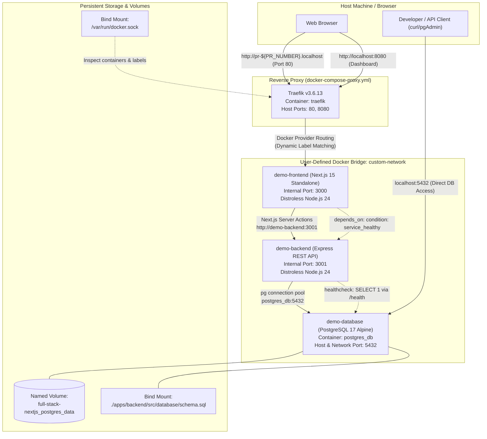

# Docker Documentation: Full-Stack Next.js Monorepo

Welcome to the Docker guide for this Turborepo full-stack application. This document details the container architecture, provides explanations of the Docker concepts implemented, and offers step-by-step instructions to build, run, and troubleshoot the complete multi-service stack on any development machine.

---

## Table of Contents

1. [A. Project Overview](#a-project-overview)
2. [B. Project Structure](#b-project-structure)
3. [C. Docker Concepts Used in This Project](#c-docker-concepts-used-in-this-project)
4. [D. Prerequisites](#d-prerequisites)
5. [E. Environment Variables and Configuration](#e-environment-variables-and-configuration)
6. [F. Build and Run the Application](#f-build-and-run-the-application)
7. [G. Frontend and Backend Dockerfiles](#g-frontend-and-backend-dockerfiles)
8. [H. Docker Compose Configuration](#h-docker-compose-configuration)
9. [I. Common Problems and Solutions](#i-common-problems-and-solutions)
10. [J. Quick Reference](#j-quick-reference)

---

## A. Project Overview

### What Docker Is and Why This Project Uses It

**Docker** is a containerization platform that packages an application and all its runtime dependencies (system libraries, Node.js runtime, configuration, and packages) into a portable, isolated unit called a **container**.

In this repository, setting up the application manually would require:
- Matching exact Node.js engine versions (Node 24).
- Installing and matching package managers via Corepack (`pnpm`).
- Installing, configuring, and running PostgreSQL 17 locally with the required extensions (`pgcrypto`) and schemas.
- Setting up a reverse proxy or local DNS routing for multi-tenant / dynamic preview routing.

Docker eliminates "works on my machine" inconsistencies by packaging each service with its exact dependencies into immutable containers that behave identically across macOS, Linux, and Windows (WSL2).

### The Purpose of Docker Compose in This Application

While Docker runs individual containers, **Docker Compose** is an orchestration tool that defines and runs multi-container Docker applications. Compose allows configuring the database, reverse proxy, backend API, and frontend web server in declarative YAML files and starting or stopping all interconnected services with a single command.

### How the Services Work Together

This application consists of four distinct services:
1. **`demo-database` (PostgreSQL 17 Alpine)**:
   - Persists application data in a dedicated named volume (`full-stack-nextjs_postgres_data`).
   - Executes initialization SQL schema (`apps/backend/src/database/schema.sql`) on fresh startups.
   - Validates its readiness using `pg_isready`.
2. **`demo-backend` (Node.js 24 / Express REST API)**:
   - Connects to `demo-database` over the internal Docker network on port `5432`.
   - Exposes REST endpoints (e.g., `/tasks`) and a `/health` endpoint that queries PostgreSQL (`SELECT 1`).
   - Runs on a secure Google Distroless runtime image (`gcr.io/distroless/nodejs24-debian13`).
3. **`demo-frontend` (Next.js 15 Standalone Web Application)**:
   - Renders UI and executes Next.js Server Actions.
   - Server Actions communicate directly with `demo-backend` across the internal Docker network (`http://demo-backend:3001`).
   - Depends on `demo-backend` reaching a healthy status before starting (`condition: service_healthy`).
   - Runs on Google Distroless with Next.js `standalone` output.
4. **`traefik` (Traefik v3.6 Edge Router / Reverse Proxy)**:
   - Acts as the unified gateway listening on host ports `80` (HTTP) and `8080` (Traefik Dashboard).
   - Monitors the Docker daemon via the Docker socket to dynamically discover services.
   - Routes incoming HTTP requests matching `pr-${PR_NUMBER}.localhost` directly to the frontend service container.

### Architecture Diagram



---

## B. Project Structure

The table and tree below show the Docker-relevant files across the monorepo:

```text
full-stack-nextjs/
├── docker-compose.yml                  # Application services: demo-backend & demo-frontend
├── docker-compose-infrastructure.yml   # Database service: demo-database (PostgreSQL)
├── docker-compose-proxy.yml            # Dynamic edge router: Traefik v3
├── package.json                        # Root monorepo workspace package configuration
├── pnpm-lock.yaml                      # Dependency lockfile for all packages & apps
├── pnpm-workspace.yaml                 # pnpm workspace definition (apps/*, packages/*)
├── apps/
│   ├── backend/
│   │   ├── Dockerfile                  # Multi-stage Dockerfile for Express backend
│   │   ├── .dockerignore               # Backend-specific ignore rules
│   │   ├── .env                        # Local backend environment variables (gitignored)
│   │   ├── package.json                # Backend dependency declarations
│   │   └── src/
│   │       ├── health_check.ts         # Node.js healthcheck client script
│   │       ├── server.ts               # Express entry point
│   │       └── database/
│   │           ├── db.ts               # PostgreSQL connection pool configuration
│   │           └── schema.sql          # DB schema mounted into postgres init directory
│   └── frontend/
│       ├── Dockerfile                  # Multi-stage Dockerfile for Next.js standalone
│       ├── .dockerignore               # Frontend-specific ignore rules
│       ├── .env                        # Local frontend environment variables (gitignored)
│       ├── next.config.ts              # Next.js configuration (output: "standalone")
│       ├── package.json                # Frontend dependency declarations
│       └── src/
│           └── api/client.ts           # Axios client configured with NEXT_PUBLIC_BASE_URI
└── packages/
    ├── eslint-config/                  # Shared ESLint package
    ├── typescript-config/              # Shared TypeScript configurations
    └── ui/                             # Shared UI components package
```

### Purpose of Docker-Related Files

- **`docker-compose.yml`**: Defines the application runtime (`demo-backend` and `demo-frontend`). Specifies build contexts, internal exposed ports, Traefik dynamic labels, healthchecks, and service dependencies.
- **`docker-compose-infrastructure.yml`**: Defines the stateful infrastructure (`demo-database`), mounting persistent data volume and initial SQL schemas.
- **`docker-compose-proxy.yml`**: Defines `traefik`, the reverse proxy routing traffic from host port 80 to dynamic frontend instances.
- **`apps/backend/Dockerfile`**: Four-stage build (`base`, `deps`, `builder`, `runner`) that installs monorepo dependencies, builds the Express TypeScript bundle, prunes dev dependencies via `pnpm deploy --prod`, and produces a distroless container.
- **`apps/frontend/Dockerfile`**: Four-stage build that compiles Next.js in `standalone` mode, packaging server code, static files, and public assets into a distroless runtime container.
- **`apps/backend/.dockerignore` & `apps/frontend/.dockerignore`**: Exclude local build artifacts (`.next`, `dist`), local `node_modules`, cache directories (`.turbo`), and local `.env` files from being copied into the build image.
- **`apps/backend/src/database/schema.sql`**: Executed automatically by PostgreSQL during initial volume creation to create the `task` table and enable `pgcrypto`.
- **`apps/backend/src/health_check.ts`**: Standalone Node script executed by the backend Docker healthcheck probe to verify HTTP and database connectivity inside the container.

---

## C. Docker Concepts Used in This Project

### 1. Docker Image
- **Definition**: A read-only, immutable blueprint containing the application code, libraries, runtime binaries, and environment definitions needed to run a service.
- **Application here**: Custom images are built for `demo-backend` and `demo-frontend`, while public pre-built images are pulled for `postgres:17-alpine` and `traefik:v3.6.13`.
- **Example**:
  ```yaml
  # Pulled public image
  image: postgres:17-alpine
  ```

### 2. Docker Container
- **Definition**: A lightweight, isolated, runnable instance of an image. Multiple containers can run from the same image simultaneously without interference.
- **Application here**: Container `postgres_db` runs the database engine; `traefik` runs the proxy; `demo-backend` and `demo-frontend` execute the application logic.

### 3. Dockerfile
- **Definition**: A text script containing sequential instructions (`FROM`, `WORKDIR`, `COPY`, `RUN`, `CMD`) used by the Docker engine to assemble an image.
- **Application here**: `apps/backend/Dockerfile` and `apps/frontend/Dockerfile` assemble production images using Alpine Node 24 for building and Google Distroless for running.

### 4. Docker Compose
- **Definition**: A tool for defining and running multi-container Docker applications via declarative YAML configurations, managing networks, volumes, environment variables, and startup sequences.
- **Application here**: Orchestrates 4 services divided logically across `docker-compose.yml`, `docker-compose-infrastructure.yml`, and `docker-compose-proxy.yml`.

### 5. Build Context
- **Definition**: The set of local files sent to the Docker daemon when executing `docker build`.
- **Application here**: Both `demo-backend` and `demo-frontend` set `context: .` (the monorepo root) rather than their subfolders. This allows the build steps to access root files (`pnpm-lock.yaml`, `pnpm-workspace.yaml`) and shared libraries (`packages/*`).
- **Example from `docker-compose.yml`**:
  ```yaml
  demo-backend:
    build:
      context: .
      dockerfile: apps/backend/Dockerfile
  ```

### 6. Ports and Port Mapping (`expose` vs `ports`)
- **Definition**:
  - `ports` (`HOST:CONTAINER`): Publishes a container port to the host machine interface, making it accessible from outside Docker (e.g., in a host browser).
  - `expose`: Documents that a container listens on a port and makes it accessible *only* to other containers on the same Docker network, but **not** to the host.
- **Application here**:
  - `demo-database` uses `ports: ["5432:5432"]` so developers can connect GUI tools (e.g., DBeaver, TablePlus, `psql`) directly.
  - `traefik` uses `ports: ["80:80", "8080:8080"]` to accept external web traffic.
  - `demo-backend` and `demo-frontend` use `expose: [3001]` and `expose: [3000]`. They are protected from direct host access and accessed via Traefik or internal container calls.

### 7. Container Networking and Service Discovery
- **Definition**: Docker's embedded DNS server allows containers attached to the same user-defined bridge network to discover and reach each other using service or container names instead of IP addresses.
- **Application here**:
  - Network name: `custom-network` (user-defined external bridge network).
  - `demo-backend` connects to the database via `DB_HOST=postgres_db` (resolves to the `demo-database` container).
  - `demo-frontend` connects to the API via `NEXT_PUBLIC_BASE_URI=http://demo-backend:3001`.
  - Traefik reaches the frontend container via its internal IP on `custom-network`.

### 8. Environment Variables and `.env` Files
- **Definition**: Key-value configuration pairs injected into containers at runtime to configure behavior without changing code.
- **Application here**: Compose uses `${VARIABLE}` syntax to interpolate values from host environment variables or a root `.env` file into container environments.
- **Example from `docker-compose.yml`**:
  ```yaml
  environment:
    - PORT=${PORT}
    - POSTGRES_USER=${POSTGRES_USER}
    - POSTGRES_PASSWORD=${POSTGRES_PASSWORD}
    - POSTGRES_DB=${POSTGRES_DB}
    - DB_HOST=${DB_HOST}
    - DB_PORT=${DB_PORT}
  ```

### 9. Volumes and Bind Mounts
- **Definition**:
  - **Named Volumes**: Storage managed directly by Docker in `/var/lib/docker/volumes/`, decoupled from container lifecycles for persistent data.
  - **Bind Mounts**: Direct mappings of a specific host file or directory path into the container filesystem.
- **Application here**:
  - **Named volume**: `postgres_data` (mapped to `full-stack-nextjs_postgres_data`) persists PostgreSQL data across container restarts and updates.
  - **Bind mount (file)**: `./apps/backend/src/database/schema.sql:/docker-entrypoint-initdb.d/schema.sql` binds the local SQL file into the Postgres init directory.
  - **Bind mount (socket)**: `/var/run/docker.sock.raw:/var/run/docker.sock` allows Traefik to query the Docker API to detect active containers and route labels.

### 10. Docker Layers and Build Cache
- **Definition**: Each line in a Dockerfile produces a read-only filesystem layer. Docker caches layers and reuses them in subsequent builds if the instruction and preceding files have not changed.
- **Application here**: Both Dockerfiles copy `package.json`, `pnpm-lock.yaml`, and `pnpm-workspace.yaml` *before* copying application source code (`COPY . .`). This ensures expensive `pnpm install` steps are cached unless dependencies change.
- **Example from `apps/backend/Dockerfile`**:
  ```dockerfile
  FROM base AS deps
  COPY pnpm-workspace.yaml pnpm-lock.yaml package.json ./
  COPY apps/backend/package.json ./apps/backend/package.json
  COPY packages/ui/package.json ./packages/ui/package.json
  COPY packages/typescript-config/package.json ./packages/typescript-config/package.json
  COPY packages/eslint-config/package.json ./packages/eslint-config/package.json
  RUN pnpm install --frozen-lockfile   # Cached if package.json & lockfile are unchanged!
  ```

### 11. `.dockerignore`
- **Definition**: A file specifying pattern rules for files and directories that should be excluded from the Docker build context.
- **Application here**: Prevents massive folders (`node_modules`, `.next`, `dist`, `.turbo`), Git history (`.git`), and secret files (`.env`) from inflating build context transfer times or leaking into images.

### 12. Service Dependencies and Health Checks
- **Definition**:
  - `healthcheck`: Periodic command executed by Docker inside a container to determine whether the service is functioning, not merely whether its process is alive.
  - `depends_on` with `condition: service_healthy`: Prevents dependent services from starting until the dependency's healthcheck passes.
- **Application here**:
  - `demo-database` verifies Postgres readiness with `pg_isready`.
  - `demo-backend` runs `/nodejs/bin/node dist/src/health_check.js`, which issues an HTTP request to `http://127.0.0.1:3001/health` (which verifies `SELECT 1` on PostgreSQL).
  - `demo-frontend` will not boot until `demo-backend` is healthy.
- **Example from `docker-compose.yml`**:
  ```yaml
  depends_on:
    demo-backend:
      condition: service_healthy
  ```

### 13. Container Logs and Troubleshooting
- **Definition**: Docker captures all output written to container standard output (`stdout`) and standard error (`stderr`) streams and makes it accessible through `docker logs`.
- **Application here**: Express and Next.js log server boot messages, HTTP traffic, and database errors directly to console streams inspected with `docker compose logs -f`.

### 14. Multi-Stage Builds
- **Definition**: A Dockerfile pattern utilizing multiple `FROM` instructions where intermediate artifacts from build stages are copied into a final, minimal runtime stage, leaving build tools, dev dependencies, and source files behind.
- **Application here**: Both `Dockerfile` files implement four distinct stages:
  1. `base`: Configures Node 24 Alpine with Corepack.
  2. `deps`: Installs full workspace dependencies.
  3. `builder`: Compiles TypeScript with Turborepo (`turbo build`).
  4. `runner`: Ultra-compact runtime using Google Distroless (`gcr.io/distroless/nodejs24-debian13`).

### 15. Restart Policies and Container Lifecycle
- **Definition**: Directives instructing the Docker daemon how to handle container termination or system reboots.
- **Application here**:
  - `restart: always`: Configured on `demo-backend` and `demo-database` to ensure immediate restart if the process crashes or host reboots.
  - `restart: unless-stopped`: Configured on `traefik`, keeping the router alive unless manually stopped by the developer.

---

## D. Prerequisites

Before running the application, ensure the host machine has the following tools installed:

### Required Software
- **Docker Engine**: Version `24.0.0` or higher ([Official Install Guide](https://docs.docker.com/engine/install/))
- **Docker Compose**: Modern Compose V2 (`docker compose` CLI plugin), version `2.20.0` or higher ([Docker Compose Install Guide](https://docs.docker.com/compose/install/))
  *Note: Use `docker compose` with a space, not the deprecated `docker-compose` v1 binary.*

### Operating System Considerations
- **Linux**:
  - Ensure your user belongs to the `docker` group:
    ```bash
    sudo usermod -aG docker $USER
    newgrp docker
    ```
  - Verify that the Docker daemon socket is active at `/var/run/docker.sock`.
  - *Traefik Docker socket*: `docker-compose-proxy.yml` references `/var/run/docker.sock.raw:/var/run/docker.sock`. On standard Linux systems without Docker Desktop, `/var/run/docker.sock.raw` does not exist. Change this to `/var/run/docker.sock:/var/run/docker.sock` if running standard Linux Docker Engine.
- **macOS / Windows**:
  - Install [Docker Desktop](https://docs.docker.com/desktop/).
  - Ensure Docker Desktop is running. Docker Desktop supports the `/var/run/docker.sock.raw` socket mount.
  - On Windows, enable the WSL2 backend.

### Verifying Installation

Run the following commands in your terminal:

```bash
docker --version
docker compose version
```

Expected output should resemble:
```text
Docker version 27.x.x, build ...
Docker Compose version v2.x.x
```

---

## E. Environment Variables and Configuration

Docker Compose and the application services require specific configuration variables.

### Required Variables Reference

| Variable Name | Required By | Description | Example / Default |
|---|---|---|---|
| `PORT` | `demo-backend` | Port Express backend listens on inside container | `3001` |
| `POSTGRES_USER` | `demo-database`, `demo-backend` | PostgreSQL superuser username | `postgres` |
| `POSTGRES_PASSWORD` | `demo-database`, `demo-backend` | PostgreSQL superuser password | `postgres` |
| `POSTGRES_DB` | `demo-database`, `demo-backend` | Target PostgreSQL database name | `demo_docker` |
| `DB_HOST` | `demo-database`, `demo-backend` | Hostname of the database container | `postgres_db` |
| `DB_PORT` | `demo-backend` | Port PostgreSQL listens on | `5432` |
| `NEXT_PUBLIC_BASE_URI` | `demo-frontend` | Base URL used by Next.js Server Actions to query backend | `http://demo-backend:3001` |
| `PR_NUMBER` | `demo-frontend` / Traefik | Identifier used to construct Traefik Host router rule | `local` (or pull request number) |

### Environment Configuration Files

In this monorepo, environment files exist at:
- `apps/backend/.env`: Used when running backend locally outside Docker.
- `apps/frontend/.env`: Used when running frontend locally outside Docker.

> [!IMPORTANT]
> **Why a Root `.env` Is Required for Docker Compose:**
> In `docker-compose.yml`, the `env_file:` directives are commented out, and environment entries use variable substitution (e.g., `POSTGRES_USER=${POSTGRES_USER}`).
> When running `docker compose` from the repository root, Compose looks for a `.env` file **in the root directory** to interpolate these variables. If no root `.env` exists, variables default to blank strings, causing container startup warnings.

### Creating Your Root `.env` File

Create a file named `.env` at the root of the repository:

```bash
# Full-Stack Next.js Monorepo Environment Configuration
# Project: full-stack-nextjs

# -------------------------------------------------------------
# Networking & Routing Configuration
# -------------------------------------------------------------
# Used by Traefik to create the Host route: pr-${PR_NUMBER}.localhost
PR_NUMBER=local

# -------------------------------------------------------------
# Backend API Configuration
# -------------------------------------------------------------
PORT=3001

# -------------------------------------------------------------
# PostgreSQL Database Configuration
# -------------------------------------------------------------
POSTGRES_USER=postgres
POSTGRES_PASSWORD=postgres
POSTGRES_DB=demo_docker
DB_HOST=postgres_db
DB_PORT=5432

# -------------------------------------------------------------
# Frontend Configuration
# -------------------------------------------------------------
# Inside Docker, Next.js server actions call the backend container directly
NEXT_PUBLIC_BASE_URI=http://demo-backend:3001
```

### Security & Secret Management Rules

1. **Never Commit Real Credentials**: Real `.env` files containing production secrets must be listed in `.gitignore` and never committed to version control.
2. **Next.js Client-Side Variables (`NEXT_PUBLIC_*`)**: Any variable prefixed with `NEXT_PUBLIC_` is accessible to the browser client. **Never place database passwords or private API keys in `NEXT_PUBLIC_*` variables.**
3. **Build Arguments vs Runtime Variables**: Do not bake credentials into Docker image layers with `ARG` or `ENV` in Dockerfiles. Always inject passwords at runtime through Docker Compose environment blocks.

---

## F. Build and Run the Application

Follow these exact steps to start the complete application stack from scratch.

### Step 1: Clone the Repository and Navigate to Root

```bash
cd /path/to/full-stack-nextjs
```

### Step 2: Create the External Docker Network

All three compose files specify `custom-network: external: true`. You must create this network once before running the compose commands:

```bash
docker network create custom-network
```

*If the network already exists, Docker will indicate it; you can safely proceed.*

### Step 3: Create the Root Environment File

Ensure the root `.env` file exists as described in [Section E](#creating-your-root-env-file):

```bash
test -f .env || cat << 'EOF' > .env
PR_NUMBER=local
PORT=3001
POSTGRES_USER=postgres
POSTGRES_PASSWORD=postgres
POSTGRES_DB=demo_docker
DB_HOST=postgres_db
DB_PORT=5432
NEXT_PUBLIC_BASE_URI=http://demo-backend:3001
EOF
```

### Step 4: Validate the Compose Configuration

Verify that all environment variables interpolate cleanly without warnings:

```bash
docker compose -f docker-compose-infrastructure.yml -f docker-compose-proxy.yml -f docker-compose.yml config
```

### Step 5: Start the Infrastructure Services (Database & Proxy)

Start the PostgreSQL database and Traefik reverse proxy in detached mode (`-d`):

```bash
docker compose -f docker-compose-infrastructure.yml up -d
docker compose -f docker-compose-proxy.yml up -d
```

Check that the database is healthy before proceeding:

```bash
docker compose -f docker-compose-infrastructure.yml ps
```

### Step 6: Build and Start the Application Services (Backend & Frontend)

Build the Docker images and launch the backend and frontend services:

```bash
docker compose up --build -d
```

*(Alternatively, run without `-d` to view live logs directly in your terminal: `docker compose up --build`)*

### Unified One-Command Startup (All Services)

You can also start all three Compose files simultaneously with a single command:

```bash
docker compose -f docker-compose-infrastructure.yml -f docker-compose-proxy.yml -f docker-compose.yml up --build -d
```

### Step 7: Verify Running Containers and Health Status

List all running containers and verify their health probes:

```bash
docker compose -f docker-compose-infrastructure.yml -f docker-compose-proxy.yml -f docker-compose.yml ps
```

Expected output:
```text
NAME           IMAGE                        COMMAND                  SERVICE         CREATED         STATUS                   PORTS
postgres_db    postgres:17-alpine           "docker-entrypoint.s…"   demo-database   Up 20 seconds   Up 20 seconds (healthy)  0.0.0.0:5432->5432/tcp
traefik        traefik:v3.6.13              "/entrypoint.sh --ap…"   traefik         Up 15 seconds   Up 15 seconds            0.0.0.0:80->80/tcp, 0.0.0.0:8080->8080/tcp
demo-backend   full-stack-nextjs-demo-backend "/nodejs/bin/node di…" demo-backend   Up 10 seconds   Up 10 seconds (healthy)  3001/tcp
demo-frontend  full-stack-nextjs-demo-frontend "/nodejs/bin/node ap…" demo-frontend  Up 5 seconds    Up 5 seconds             3000/tcp
```

### Step 8: Access the Application Endpoints

Open your browser or run `curl`:

1. **Frontend Application**:
   - **URL**: [http://pr-local.localhost](http://pr-local.localhost) (when `PR_NUMBER=local`)
   - *Note*: Modern browsers automatically resolve `*.localhost` to `127.0.0.1`.
2. **Traefik Dashboard**:
   - **URL**: [http://localhost:8080](http://localhost:8080)
   - View registered HTTP routers, entrypoints, and services.
3. **Backend Health Check & API**:
   - The backend exposes port `3001` internally. If host port mapping `"3001:3001"` is uncommented in `docker-compose.yml`, test:
     ```bash
     curl http://localhost:3001/health
     # Expected: {"status":"healthy","database":"connected"}
     ```
4. **PostgreSQL Database**:
   - Connect with your database client (e.g. `psql -h localhost -p 5432 -U postgres -d demo_docker`).

### Step 9: Inspecting Logs

To view aggregated real-time logs from all application containers:

```bash
docker compose logs -f
```

To tail logs for a specific service:

```bash
docker compose logs -f demo-backend
docker compose logs -f demo-frontend
docker compose -f docker-compose-infrastructure.yml logs -f demo-database
```

### Step 10: Stopping the Application

To gracefully stop running containers without losing data:

```bash
# Stop application services
docker compose stop

# Stop all services
docker compose -f docker-compose-infrastructure.yml -f docker-compose-proxy.yml -f docker-compose.yml stop
```

To resume stopped containers:

```bash
docker compose start
```

### Step 11: Rebuilding Images After Code Changes

When source code or packages in `apps/` or `packages/` change, rebuild images:

```bash
docker compose up --build -d
```

If you made modifications to dependencies and suspect a stale build cache:

```bash
docker compose build --no-cache
docker compose up -d
```

### Step 12: Stopping and Removing Containers

To stop and remove containers and internal networks:

```bash
docker compose down
docker compose -f docker-compose-proxy.yml down
docker compose -f docker-compose-infrastructure.yml down
```

### Step 13: Resetting Persistent Data (Volume Removal)

> [!CAUTION]
> **Data Loss Warning**: Running `docker compose down -v` permanently destroys Docker volumes, deleting all PostgreSQL database tables, records, and data.

To perform a complete reset including database volumes:

```bash
docker compose -f docker-compose-infrastructure.yml down -v
```

---

## G. Frontend and Backend Dockerfiles

Both applications use production-grade, multi-stage Dockerfiles leveraging Alpine for the build environment and Google Distroless for the production runtime.

### 1. Backend Dockerfile (`apps/backend/Dockerfile`)

```dockerfile
# Stage 1: Base image
FROM node:24-alpine AS base
RUN corepack enable
WORKDIR /build

# Stage 2: Dependency installation
FROM base AS deps
COPY pnpm-workspace.yaml pnpm-lock.yaml package.json ./
COPY apps/backend/package.json ./apps/backend/package.json
COPY packages/ui/package.json ./packages/ui/package.json
COPY packages/typescript-config/package.json ./packages/typescript-config/package.json
COPY packages/eslint-config/package.json ./packages/eslint-config/package.json
RUN pnpm install --frozen-lockfile

# Stage 3: Build & deploy pruning
FROM deps AS builder
COPY . .
RUN npx turbo build --filter=backend
RUN pnpm --filter backend deploy --prod /prod/backend

# Stage 4: Production Distroless Runner
FROM gcr.io/distroless/nodejs24-debian13 AS runner
WORKDIR /app
COPY --from=builder /prod/backend ./

EXPOSE 3001
CMD ["dist/src/server.js"]
```

#### Detailed Breakdown of Backend Stages:
- **Base Image (`node:24-alpine`)**:
  - Provides a minimal Linux environment with Node.js 24.
  - `corepack enable` activates `pnpm` without installing it globally.
- **Dependency Stage (`deps`)**:
  - Selectively copies only package manifests and lockfiles from the monorepo root and dependent packages.
  - Runs `pnpm install --frozen-lockfile` to ensure exact dependency tree reproduction.
  - Because code changes do not alter manifests, Docker reuses this layer from cache during builds.
- **Builder Stage (`builder`)**:
  - Copies the full source tree (`COPY . .`).
  - Executes Turborepo build scoped to the backend (`npx turbo build --filter=backend`), compiling TypeScript files into `dist/`.
  - Executes `pnpm --filter backend deploy --prod /prod/backend`, which gathers the compiled backend and only its production dependencies into an isolated `/prod/backend` directory.
- **Production Runner (`gcr.io/distroless/nodejs24-debian13`)**:
  - Contains **only** the Node.js runtime and its minimal shared libraries. It has no shell (`/bin/sh`), package manager (`apk`, `apt`), or build tools.
  - Greatly reduces attack surface and image size.
  - Copies `/prod/backend` to `/app`.
  - `EXPOSE 3001` documents the backend listening port.
  - `CMD ["dist/src/server.js"]` starts the Express server.

---

### 2. Frontend Dockerfile (`apps/frontend/Dockerfile`)

```dockerfile
# Stage 1: Base image
FROM node:24-alpine AS base
RUN corepack enable
WORKDIR /build

# Stage 2: Dependency installation
FROM base AS deps
COPY pnpm-workspace.yaml pnpm-lock.yaml package.json ./
COPY apps/frontend/package.json ./apps/frontend/package.json
COPY packages/ui/package.json ./packages/ui/package.json
COPY packages/typescript-config/package.json ./packages/typescript-config/package.json
COPY packages/eslint-config/package.json ./packages/eslint-config/package.json
RUN pnpm install --frozen-lockfile

# Stage 3: Next.js Standalone Build
FROM deps AS builder
COPY . .
RUN npx turbo build --filter=frontend

# Stage 4: Production Distroless Runner
FROM gcr.io/distroless/nodejs24-debian13 AS runner
WORKDIR /app
COPY --from=builder /build/apps/frontend/.next/standalone ./
COPY --from=builder /build/apps/frontend/.next/static ./apps/frontend/.next/static
COPY --from=builder /build/apps/frontend/public ./apps/frontend/public

EXPOSE 3000
CMD ["apps/frontend/server.js"]
```

#### Detailed Breakdown of Frontend Stages:
- **Standalone Build Optimization (`apps/frontend/next.config.ts`)**:
  - Configured with `output: "standalone"`.
  - During `npx turbo build --filter=frontend`, Next.js analyzes dependency graphs and creates an autonomous bundle in `.next/standalone` containing only production code and required node_modules.
- **Asset Separation in Runner Stage**:
  - Next.js standalone output excludes static and public assets to maintain lightweight server builds.
  - The Dockerfile explicitly copies:
    1. Standalone server bundle: `/build/apps/frontend/.next/standalone -> ./`
    2. Static assets: `/build/apps/frontend/.next/static -> ./apps/frontend/.next/static`
    3. Public files: `/build/apps/frontend/public -> ./apps/frontend/public`
  - Starts Next.js with `CMD ["apps/frontend/server.js"]`.

---

## H. Docker Compose Configuration

The Compose configuration is modularized into three files according to service lifecycle.

### Service Overview Table

| Service Name | Compose File | Base Image / Build | Published Host Port | Internal Network Port | Volumes / Mounts | Restart Policy | Healthcheck |
|---|---|---|---|---|---|---|---|
| `traefik` | `docker-compose-proxy.yml` | `traefik:v3.6.13` | `80:80`, `8080:8080` | `80`, `8080` | `/var/run/docker.sock` | `unless-stopped` | None |
| `demo-database` | `docker-compose-infrastructure.yml` | `postgres:17-alpine` | `5432:5432` | `5432` | `postgres_data`, `schema.sql` | `always` | `pg_isready` |
| `demo-backend` | `docker-compose.yml` | `apps/backend/Dockerfile` | None *(Host port 3001 commented out)* | `3001` | None | `always` | Node HTTP probe on `/health` |
| `demo-frontend` | `docker-compose.yml` | `apps/frontend/Dockerfile` | None *(Host port 3000 commented out)* | `3000` | None | None | None *(depends on backend health)* |

---

### Deep Dive by Service

#### 1. `traefik` (`docker-compose-proxy.yml`)
- **Role**: Edge router and dynamic reverse proxy.
- **Key Flags**:
  - `--api.dashboard=true` and `--api.insecure=true`: Enables the Traefik web UI on port `8080`.
  - `--providers.docker=true`: Enables Docker container auto-discovery.
  - `--providers.docker.exposedbydefault=false`: Containers must explicitly declare `traefik.enable=true` to be routed.
  - `--entrypoints.web.address=:80`: Sets up port 80 for HTTP routing.
- **Docker Socket Mount**: Traefik reads container metadata and labels through `/var/run/docker.sock`.

#### 2. `demo-database` (`docker-compose-infrastructure.yml`)
- **Role**: PostgreSQL database storage.
- **Container Name**: `postgres_db` (used by backend as hostname: `DB_HOST=postgres_db`).
- **Healthcheck**:
  ```yaml
  healthcheck:
    test: ["CMD-SHELL", "pg_isready -U $$POSTGRES_USER -d $$POSTGRES_DB"]
    interval: 5s
    timeout: 5s
    retries: 5
    start_period: 5s
  ```
- **Initialization Bind Mount**:
  `./apps/backend/src/database/schema.sql:/docker-entrypoint-initdb.d/schema.sql` creates the database tables automatically on first startup.

#### 3. `demo-backend` (`docker-compose.yml`)
- **Role**: REST API server.
- **Port Exposure**: Declares `expose: [3001]` on `custom-network`.
- **Healthcheck**:
  ```yaml
  healthcheck:
    test: ["CMD", "/nodejs/bin/node", "dist/src/health_check.js"]
    interval: 10s
    timeout: 5s
    retries: 5
    start_period: 15s
  ```
  *Note*: Uses `/nodejs/bin/node` because distroless images do not contain a shell (`/bin/sh`).

#### 4. `demo-frontend` (`docker-compose.yml`)
- **Role**: Web UI.
- **Traefik Labels**:
  - `traefik.enable=true`: Tells Traefik to route to this container.
  - `traefik.http.routers.pr-${PR_NUMBER}.rule=Host(\`pr-${PR_NUMBER}.localhost\`)`: Dynamically maps the domain to this service.
  - `traefik.http.services.pr-${PR_NUMBER}.loadbalancer.server.port=3000`: Forwards incoming port 80 traffic to container port 3000.
- **Startup Dependency**:
  ```yaml
  depends_on:
    demo-backend:
      condition: service_healthy
  ```
  Guarantees that frontend Server Actions do not fail on startup due to an unready backend or database.

---

## I. Common Problems and Solutions

### 1. Error: `network custom-network declared as external, but could not be found`
- **Cause**: All Compose files configure `custom-network` as an external network. Docker will not create it automatically.
- **Diagnostic Command**:
  ```bash
  docker network ls
  ```
- **Fix**:
  Create the network before running Compose:
  ```bash
  docker network create custom-network
  ```

---

### 2. Warning: `The "POSTGRES_USER" variable is not set. Defaulting to a blank string.`
- **Cause**: No `.env` file exists at the root of the repository, or Compose was run without `--env-file`.
- **Diagnostic Command**:
  ```bash
  docker compose config
  ```
- **Fix**:
  Create a root `.env` file as documented in [Section E](#creating-your-root-env-file).

---

### 3. Traefik Router Shows `pr-.localhost` (Missing `PR_NUMBER`)
- **Cause**: The `PR_NUMBER` environment variable is not defined in the root `.env` or current shell.
- **Diagnostic Command**:
  ```bash
  docker compose config | grep -i "rule"
  ```
- **Fix**:
  Set `PR_NUMBER=local` (or a PR number) in your root `.env` file.

---

### 4. `docker exec -it <container> sh` Fails with `OCI runtime exec failed: exec: "sh": executable file not found in $PATH`
- **Cause**: Both `demo-backend` and `demo-frontend` use Google Distroless runtime images (`gcr.io/distroless/nodejs24-debian13`). Distroless images deliberately omit `/bin/sh`, `/bin/bash`, and package managers for security.
- **Fix**:
  - You cannot open an interactive shell in distroless containers.
  - Diagnose issues via container logs:
    ```bash
    docker compose logs -f demo-backend
    ```
  - For deep debugging, you can execute Node directly if necessary:
    ```bash
    docker compose exec demo-backend /nodejs/bin/node -e "console.log(process.env)"
    ```

---

### 5. `demo-frontend` Waits Indefinitely or Fails to Start
- **Cause**: `demo-frontend` specifies `depends_on: demo-backend: condition: service_healthy`. If the backend healthcheck fails, the frontend will never start.
- **Diagnostic Command**:
  ```bash
  docker compose ps demo-backend
  docker compose logs demo-backend
  ```
- **Fix**:
  The backend healthcheck queries `SELECT 1` on PostgreSQL via `/health`. Check whether:
  1. `demo-database` is running and healthy (`docker compose -f docker-compose-infrastructure.yml ps`).
  2. Database credentials in `.env` match between `demo-database` and `demo-backend`.
  3. `DB_HOST` is set to `postgres_db` (the container name on `custom-network`), **not** `localhost`.

---

### 6. Traefik Mount Error: `/var/run/docker.sock.raw: no such file or directory` (Linux Users)
- **Cause**: `docker-compose-proxy.yml` mounts `/var/run/docker.sock.raw`, which is specific to Docker Desktop (macOS/Windows). Standard Linux distributions use `/var/run/docker.sock`.
- **Diagnostic Command**:
  ```bash
  ls -la /var/run/docker.sock*
  ```
- **Fix**:
  If running on Linux Docker Engine without Docker Desktop, update the volume in `docker-compose-proxy.yml` to:
  ```yaml
  volumes:
    - /var/run/docker.sock:/var/run/docker.sock
  ```

---

### 7. Port Collision: `bind: address already in use` for Ports 80, 5432, or 8080
- **Cause**: Another service on your host is already bound to that port (e.g., local PostgreSQL on 5432, local Nginx/Apache on 80).
- **Diagnostic Command**:
  ```bash
  sudo lsof -i :5432
  sudo lsof -i :80
  ```
- **Fix**:
  - Stop the host service:
    ```bash
    sudo systemctl stop postgresql
    sudo systemctl stop nginx
    ```
  - Alternatively, change the host-side published port in the compose file (e.g., change `"5432:5432"` to `"5433:5432"`).

---

### 8. Frontend Cannot Reach Backend (`ECONNREFUSED`)
- **Cause**: Frontend Server Actions are attempting to connect to `http://localhost:3001` instead of `http://demo-backend:3001`. Inside a Docker container, `localhost` refers to the container itself, not the host or sibling containers.
- **Diagnostic Command**:
  Check `NEXT_PUBLIC_BASE_URI` in container environment:
  ```bash
  docker compose config | grep NEXT_PUBLIC_BASE_URI
  ```
- **Fix**:
  Ensure `NEXT_PUBLIC_BASE_URI=http://demo-backend:3001` in your root `.env` file and rebuild the frontend container.

---

### 9. Build Context Missing Files or Slow Build Times
- **Cause**: The build context is set to `.` (monorepo root). `.dockerignore` files currently reside in `apps/backend/` and `apps/frontend/`. Standard Docker CLI builds with root context search for `./.dockerignore` at the root.
- **Fix**:
  Ensure a `.dockerignore` exists at the root of the monorepo to ignore `**/node_modules`, `.git`, `.next`, and `dist`.

---

### 10. Docker Daemon Not Running or Permission Denied
- **Cause**: Docker service is stopped, or your non-root user lacks permission to access `/var/run/docker.sock`.
- **Diagnostic Command**:
  ```bash
  docker ps
  ```
- **Fix**:
  - Start the daemon:
    ```bash
    sudo systemctl start docker
    ```
  - Add your user to the `docker` group:
    ```bash
    sudo usermod -aG docker $USER
    newgrp docker
    ```

---

## J. Quick Reference

A cheat sheet of the most frequently used Docker Compose commands for this repository:

| Goal | Command |
|---|---|
| **Create required network** | `docker network create custom-network` |
| **Validate compose configuration** | `docker compose -f docker-compose-infrastructure.yml -f docker-compose-proxy.yml -f docker-compose.yml config` |
| **Start all services (detached)** | `docker compose -f docker-compose-infrastructure.yml -f docker-compose-proxy.yml -f docker-compose.yml up --build -d` |
| **Start application only** | `docker compose up --build -d` |
| **View all running containers** | `docker compose -f docker-compose-infrastructure.yml -f docker-compose-proxy.yml -f docker-compose.yml ps` |
| **View live logs (all apps)** | `docker compose logs -f` |
| **View backend logs** | `docker compose logs -f demo-backend` |
| **View frontend logs** | `docker compose logs -f demo-frontend` |
| **View database logs** | `docker compose -f docker-compose-infrastructure.yml logs -f demo-database` |
| **Restart a service** | `docker compose restart demo-backend` |
| **Rebuild without cache** | `docker compose build --no-cache && docker compose up -d` |
| **Stop all services** | `docker compose -f docker-compose-infrastructure.yml -f docker-compose-proxy.yml -f docker-compose.yml stop` |
| **Tear down containers & networks** | `docker compose -f docker-compose-infrastructure.yml -f docker-compose-proxy.yml -f docker-compose.yml down` |
| **Reset DB volume *(destructive)*** | `docker compose -f docker-compose-infrastructure.yml down -v` |

